# AUTOPILOT.md — self-driving build file for StudySite

You are Claude Code. This single file contains everything needed to build a personal exam-revision
website from an empty folder to a deployed site. Read PART A fully every session. Read PART B only
during bootstrap. Read PART C one phase at a time, only when the task ladder points you there.

Recommended launch: Opus 5.5, effort medium, permission mode auto. Sonnet 5 is acceptable for any
task marked [S] in the ladder.

# PART A: PROTOCOL

## A1. The one rule
Work from `STATE.md` on disk, never from memory of this conversation. Every session, first read
`STATE.md`. If it does not exist, run Bootstrap (A3). Otherwise run the Loop (A4). Nothing you decide
exists until it is written to a file and committed.

## A2. What the user will say
- "continue" (possibly after `/clear`, possibly days later): run A4.
- "status": print the ladder with ticks, blocks and the last five log lines; do nothing else.
- "unblock <task>": the user has supplied what was missing; clear that BLOCKED mark and run A4.
- Anything else: treat as a correction to the current task; apply it, re-run the task's check, commit.

## A3. Bootstrap (first run only, ~20 minutes)
1. Confirm the folder is empty or contains only this file and possibly a `raw/` folder. If a project
   already exists here, stop and ask.
2. Write every file listed in PART B verbatim to its path (create directories). Do not improve them.
3. `git init -b main` if needed (in a cloud session the repo already exists); commit "chore: starter files" and `git push`.
4. Scaffold Astro 5 into this folder without deleting the files above: `npm create astro@latest . -- --template minimal --typescript strict --no-install --no-git --yes` (if it refuses a non-empty directory, scaffold into `_scaffold/`, move its files up, delete `_scaffold/`). Then `npx astro add react --yes`, and `npm i gsap lenis three @react-three/fiber d3 zustand idb-keyval dexie ts-fsrs fuse.js pagefind @vite-pwa/astro` and `npm i -D vitest @playwright/test @types/three`. Add npm scripts: dev, build, preview, test (vitest run), e2e (playwright test), lh, validate (node scripts/validate.mjs), gate (node scripts/gate.mjs), build:index.
5. Fonts: download Fraunces (variable), Inter and JetBrains Mono WOFF2 from Google Fonts / Fontsource (npm `@fontsource-variable/fraunces @fontsource-variable/inter @fontsource-variable/jetbrains-mono` is acceptable and avoids manual downloads). Only npm registry and GitHub downloads are permitted; nothing else.
6. Create `STATE.md` from the ladder in A5, every task unticked, plus a `## Log` section. Create `docs/PROMPTS.md` by copying PART C of this file. Commit "chore: bootstrap".
7. Print the ladder and continue into A4 immediately.

## A4. The loop (every session)
1. Read `STATE.md`. Read `CLAUDE.md`. Do not read PART C yet.
2. Choose the first task that is unticked, not BLOCKED, and whose `needs:` are all ticked.
   If none: print "All tasks done or blocked" with the block reasons, and stop.
3. Print one line: `▶ <task id> <title>`.
4. Open only the PART C phase that the task cites (search this file for the heading). Do the task.
   Use subagents (three at a time, each confined to its own files) whenever the task says so.
5. Run the task's check exactly as written in the ladder. If it fails, fix and re-run, up to three
   attempts; on the third failure mark the task `FAILED: <reason>` in STATE.md, commit what is safe,
   and move to the next eligible task.
6. If the task needs something only the user can supply (raw materials, a login, a decision),
   mark it `BLOCKED: <exactly what is needed, one line>` and move on.
7. Commit with a conventional message. Tick the task. Append `- <date> <task id> done|blocked|failed — <one line>` to the Log. Commit STATE.md, then `git push` (cloud sessions are wiped when idle; anything not pushed is lost). If there is no remote yet, stop and ask the user to connect GitHub.
8. Repeat from step 1. Keep going until the user stops you or your context is nearly full
   (if you notice compaction has happened twice, finish the current task, commit, print "run /clear then say continue", and stop).

Context hygiene: never paste whole files into the conversation that you can read on demand; never
read PART B after bootstrap; never read more than one PART C phase at a time; when compaction
occurs, preserve the current task id, the list of modified files, and the last check result.

## A5. Task ladder (copy into STATE.md at bootstrap; `[S]` = fine on Sonnet)
Format: `- [ ] ID · title · needs: … · check: … · see: PART C heading`

- [ ] 1.1 [S] · Content schemas (src/content/config.ts) · needs: — · check: `npm run build` passes with seed content · see: Phase 1 step 1
- [ ] 1.2 [S] · Seed content under src/content/**/seed/ · needs: 1.1 · check: build passes; `seed: true` on every file · see: Phase 1 step 2
- [ ] 1.3 [S] · All routes rendering collection data with plain defaults · needs: 1.2 · check: Playwright visits every route, no console errors · see: Phase 1 step 3
- [ ] 1.4 [S] · tokens.css wired via base.css and Layout.astro · needs: 1.3 · check: computed body font-size 19px, background #FBF7F0 in a Playwright assertion · see: Phase 1 step 4
- [ ] 1.5 [S] · scripts/validate.mjs (cross-refs, ≥20 questions per non-seed concept) · needs: 1.2 · check: `npm run validate` passes; a fixture with a dangling concept id fails · see: Phase 1 step 5
- [ ] 1.6 [S] · Wire scripts/gate.mjs; Vitest fixture proving a removed card fails the gate · needs: 1.5 · check: `npm run gate` and `npm test` pass · see: Phase 1 step 6
- [ ] 1.7 [S] · Playwright smoke test + CI workflow green locally · needs: 1.3 · check: `npm run e2e` passes · see: Phase 1 step 7
- [ ] 2.1 · Typography, fonts (no CLS), grid, right rail, /styleguide · needs: 1.4 · check: CLS < 0.05 on /styleguide and home at both viewports · see: Phase 2 step 1
- [ ] 2.2 · src/lib/motion.ts (Lenis+GSAP one RAF, page-load/before-swap lifecycle, motion dial) · needs: 2.1 · check: Playwright test navigates three pages and asserts ScrollTrigger count is correct each time; dial persists · see: Phase 2 step 2
- [ ] 2.3 · Components with all states (Button, Card, Callout, ProgressRing, Chip, Toast, Modal, Popover, Tabs, Kbd, TimerArc, Stamp) · needs: 2.2 · check: /styleguide screenshots at both viewports in full/calm/off show every state without overlap · see: Phase 2 step 3
- [ ] 2.4 · Page-level motion and view transitions per the transition catalogue · needs: 2.3 · check: unit card → hub shared-element transition visible in a Playwright trace; reduced motion shows fades only · see: Phase 2 step 4
- [ ] 2.5 · Custom cursor + ambient paper gradient · needs: 2.4 · check: disabled on a touch viewport; native cursor restored when dial ≠ full · see: Phase 2 step 5
- [ ] 2.6 · Apply the system to skeleton pages; Lighthouse ≥ 90 · needs: 2.5 · check: Lighthouse home perf ≥ 90, a11y 100 · see: Phase 2 step 6
- [ ] 3.1 [S] · Ingest + questions for LAWS2400 (all weeks in raw/laws2400-torts) · needs: 1.6 · BLOCK if raw/laws2400-torts has no week folders with files · check: audit table; idempotence (second run → clean git status); isolation (one-word change touches only that week) · see: Phase 3
- [ ] 3.2 [S] · Same for LAWS2000 · needs: 3.1 · see: Phase 3
- [ ] 3.3 [S] · Same for LAWS2100 (essay template) · needs: 3.1 · see: Phase 3
- [ ] 3.4 [S] · Same for MGMT2094 (essay template, real-company examples) · needs: 3.1 · see: Phase 3
- [ ] 4.1 · Dexie data layer + Zustand selectors · needs: 2.3 · check: Vitest on selectors (accuracy, calibration, days-in-14, readiness) · see: Phase 4 data layer
- [ ] 4.2 · Confidence gate + MCQ with two-sided explanations + requeue rows · needs: 4.1 · check: Playwright: sure+wrong creates three requeue rows; explanation panel opens via clip-path · see: Phase 4 steps 1–2
- [ ] 4.3 · Criterion tracker + four-segment ring · needs: 4.2 · check: Vitest simulation: 3 correct → learned; 3 spaced sessions → secured · see: Phase 4 step 3
- [ ] 4.4 · Pretest gate on week pages · needs: 4.2 · check: first visit shows 5 questions before notes; skip is logged · see: Phase 4 step 4
- [ ] 4.5 · Short answer with clickable marking criteria + margin notes · needs: 4.1 · check: ticking rows updates score live; highlights matching model sentences · see: Phase 4 step 5
- [ ] 4.6 · Long answer: answer-plan step, exam-paper mode, three tiers, promotion · needs: 4.5 · check: worked tier hides next step until predicted; faded pre-fills given{}; two passes ≥70% promotes · see: Phase 4 step 6
- [ ] 4.7 · Adaptive picker with tests · needs: 4.3 · check: Vitest on weighting and requeue ordering · see: Phase 4 step 7
- [ ] 4.8 · Quiz modes incl. Match, Quick-fire, Exam sim with CBM; session recap · needs: 4.7 · check: each mode screenshot; CBM scoring test · see: Phase 4 step 8
- [ ] 4.9 [S] · Error log page · needs: 4.2 · see: Phase 4 step 9
- [ ] 5.1 · Explainer manifest + loader (pinned desktop, paced mobile) · needs: 2.4 · see: Phase 5 step 1
- [ ] 5.2 · Bases: ScrollExplainer, Simulation, Palace, ThreeScene (+ byte budget script) · needs: 5.1 · check: budget script passes; ThreeScene pauses off-screen (test) · see: Phase 5 steps 2–3
- [ ] 5.3 · Prove bases with three Torts concepts (calculus simulation, Caparo scroll, negligence palace) · needs: 5.2 · check: screenshots at 3 scroll positions, both viewports, full/off · see: Phase 5 step 4
- [ ] 6.1 [S] · Pagefind + /search · needs: 1.3 · see: Phase 6 item 1
- [ ] 6.2 [S] · Command palette with typed filters and commands · needs: 2.3 · check: Playwright opens, types, filters, navigates · see: Phase 6 item 2
- [ ] 6.3 [S] · Case/authority/clause popovers, three-density case cards, AGLC4 copy, read-aloud · needs: 2.3 · see: Phase 6 item 3
- [ ] 6.4 [S] · Backlinks, data-cursor attributes, ? cheat-sheet · needs: 6.3 · see: Phase 6 items 4–6
- [ ] 7.1 · Flashcards with ts-fsrs (cloze, occlusion, apply, sentence-to-card, Anki CSV export, optimisation) · needs: 4.1 · check: 30-day FSRS simulation test · see: Phase 7 item 1
- [ ] 7.2 · Dashboard (mastery, criterion counts, days-in-14, calibration curve, readiness) · needs: 4.3 · see: Phase 7 item 2
- [ ] 7.3 · Session start ritual, 2-minute start, What next?, Continue · needs: 7.2 · see: Phase 7 item 3
- [ ] 7.4 · TimerArc focus block, chime, session summary · needs: 2.3 · see: Phase 7 item 4
- [ ] 7.5 · Study companion panel (optional, configurable) · needs: 7.4 · see: Phase 7 item 5
- [ ] 7.6 [S] · Brown/pink noise generator, off by default, warning copy · needs: 7.4 · see: Phase 7 item 6
- [ ] 7.7 [S] · Focus mode, deep-dive mode with 45-min toast · needs: 7.4 · see: Phase 7 item 7
- [ ] 7.8 · Study plan page with if-then lines and .ics export · needs: 7.2 · see: Phase 7 item 8
- [ ] 7.9 [S] · Milestone stamps · needs: 7.2 · see: Phase 7 item 9
- [ ] 8.1 · SCENE briefs for intro and unit hub (write to docs/scenes/) · needs: 5.2 · check: both briefs exist in the 5.7 format · see: Phase 8
- [ ] 8.2 · Intro film (four beats, cursor attraction, ≤ 480 KB gz, skip, once per day) · needs: 8.1 · check: CDP trace at 4× throttle ≥ 95% frames < 16.7 ms; bundle size printed · see: Phase 8
- [ ] 8.3 · Unit hub (pinned week timeline, knowledge map, due, weakest, start button) · needs: 8.1, 7.2 · check: 6 desktop + 3 mobile screenshots in all modes · see: Phase 8
- [ ] 9.1 · Explainers for every concept with variables (Simulation) across all units · needs: 5.3, 3.x for that unit · uses subagents ×3 · see: Phase 9
- [ ] 9.2 [S] · Explainers for every remaining concept (ScrollExplainer/Palace) across all units · needs: 9.1 · uses subagents ×3 · check: manifest covers 100% of non-seed concepts · see: Phase 9
- [ ] 10.1 [S] · Read-aloud + audio recap player · needs: 6.3 · see: Phase 10 item 1
- [ ] 10.2 [S] · Annotations with margin rail · needs: 6.2 · see: Phase 10 item 2
- [ ] 10.3 [S] · Compare mode · needs: 6.3 · see: Phase 10 item 3
- [ ] 10.4 [S] · Explain-it-back · needs: 7.1 · see: Phase 10 item 4
- [ ] 10.5 [S] · PWA offline + install prompt · needs: 2.6 · see: Phase 10 item 5
- [ ] 10.6 [S] · Dark lamp-lit theme · needs: 2.6 · see: Phase 10 item 6
- [ ] 10.7 [S] · Export/import JSON (+ optional Gist sync) · needs: 4.1 · see: Phase 10 item 7
- [ ] 10.8 [S] · Image-occlusion authoring · needs: 7.1 · see: Phase 10 item 8
- [ ] 11.1 [S] · Purge seed content; gate still passes · needs: 3.1 (else BLOCK: "needs at least one real unit ingested before seed purge") · see: Phase 11 item 1
- [ ] 11.2 [S] · /audit-content all; fix everything flagged · needs: 11.1 · see: Phase 11 item 2
- [ ] 11.3 · Performance pass (code-split, lazy Three/D3, CLS, CDP traces, Lighthouse) · needs: 9.2, 8.3 · check: budgets in CLAUDE.md rule 12 all met · see: Phase 11 item 3
- [ ] 11.4 [S] · Accessibility pass · needs: 11.3 · check: Lighthouse a11y 100 on five routes · see: Phase 11 item 4
- [ ] 11.5 [S] · Deploy to Cloudflare Pages via Git integration · needs: 11.4 · make sure `npm run build` outputs to dist/ and pushes cleanly; then BLOCK: "In Cloudflare: Workers & Pages → Create → Pages → Connect to Git → studysite; build command `npm run build`, output `dist`; then say unblock 11.5 with the .pages.dev URL" · check: that URL returns 200 and renders home · see: Phase 11 item 5 (ignore its wrangler instructions)
- [ ] 11.6 [S] · README.md (add a week, regenerate, audit, deploy) · needs: 11.5 · see: Phase 11 item 6

## A6. Standing rules for autonomous mode
- Cloud sessions: push after every commit; if a download host is blocked by the network allowlist, use the npm package equivalent (e.g. @fontsource-variable/*) rather than retrying.
- Approve your own SCENE briefs and plans (the user is not present) but write them to disk first so they can be reviewed later.
- Never invent legal content. With no raw materials, build every feature against seed content and leave phases 3 and 9 blocked or partially done; the user runs `/add-week` later.
- Never download from anywhere but the npm registry, GitHub, Google Fonts/Fontsource. No browser automation is required for any task; Playwright is local.
- Choose the quieter design option whenever two are possible. Australian English.
- If a library API is uncertain, use Context7 (configured in .mcp.json) before writing it.
- Commit after every task; never leave the build broken at a commit.


# PART B: EMBEDDED PROJECT FILES (write these verbatim during bootstrap; each `### FILE:` line is the path)

### FILE: CLAUDE.md
```
# StudySite — CLAUDE.md

## What this is
A personal, static exam-revision website for four Macquarie University units:
LAWS2400 Torts, LAWS2000 Public International Law, LAWS2100 Jurisprudence,
MGMT2094 Strategic Creativity and Innovation. Exams 9–27 November 2026.
One user (Devesh, ADHD, visual learner). No accounts, no server, no paid services. Ever.
The full build plan with per-phase prompts is in docs/PLAN.md (read the relevant phase when asked; do not load it whole).

## Stack (do not substitute)
Astro 5 + React islands (client:visible default) · Markdown/MDX in src/content with Zod
collections · vanilla CSS + tokens in src/styles/tokens.css (no Tailwind) · GSAP 3.13+
(ScrollTrigger, SplitText, Flip, DrawSVG, MorphSVG; all free, public npm, no licence key) + Lenis ·
Three.js (r3f only inside islands) · D3 for the map/timelines · Pagefind + Fuse.js · Zustand +
idb-keyval, Dexie · ts-fsrs · @vite-pwa/astro · Vitest, Playwright, Lighthouse CI · Cloudflare Pages.

## Non-negotiable rules
1. Content first. Every animation directs attention to meaning or is cut.
2. Animate only transform, opacity, filter, clip-path. Never layout properties.
3. Scroll-linked motion is scrubbed (ScrollTrigger scrub). Never animate scroll position. Never hijack the wheel.
4. One RAF: Lenis raf inside gsap.ticker with lagSmoothing(0); ScrollTrigger.update on Lenis scroll.
5. Re-initialise motion on astro:page-load; kill all ScrollTriggers and destroy Lenis on astro:before-swap.
6. data-motion="full|calm|off" on <html>; every animation has calm and off states; prefers-reduced-motion forces off.
7. Prose in 66ch, left-aligned, never justified. One accent-coloured element per viewport.
8. Every interactive element has hover, active, focus-visible, disabled states; hover gated by @media (hover:hover) and (pointer:fine).
9. Keyboard-complete; ⌘K/Ctrl K palette; ? shows shortcuts.
10. Content is never invented: an authority not in raw/ materials → verify: true and listed in the audit.
11. Preserve the student's wording in notes. Restructure; do not rewrite.
12. Budgets: LCP < 1.5 s, CLS < 0.05, 60 fps at 4× CPU throttle, Lighthouse ≥ 90 perf / 100 a11y, intro chunk ≤ 480 KB gz, any explainer ≤ 120 KB gz.
13. Australian English in all UI copy and content.
14. INCREMENTAL: every generator is idempotent, content-addressed (source-hash of the raw week folder, generator-version, generated-at) and isolated to its week's id prefix. Files with locked: true are never regenerated. Re-running on unchanged input produces no diff. npm run gate must pass before any commit that touches content. Seed content lives under src/content/**/seed/ and is excluded from gate counts.
15. Commit after each completed task with a conventional message; never leave the build broken.
16. Use Context7 before writing any GSAP, Lenis, Astro, Three.js or ts-fsrs API call. Do not rely on memory for API names.

## Commands
npm run dev (localhost:4321) · build · preview · test (Vitest) · e2e (Playwright) · lh (Lighthouse CI) · validate (content checks) · gate (regression counts)

## Definition of done for any task
Builds clean; validate and gate pass; tests pass; Playwright screenshots at 1440×900 and 390×844 in
motion full, calm and off checked for overlap, console errors and CLS; committed.

## Working style
Plan first for anything touching more than three files. Prefer editing existing files over creating new ones.
When a design choice is open, choose the quieter, more restrained option. Use subagents for parallel,
file-isolated work (e.g. three weeks or three explainers at a time, each confined to its own files).
Show evidence (test output, screenshots, gate output), not claims. When compacting, preserve the list of
modified files, the current phase, and any failing check.

## Research rules (distilled; evidence in docs/PLAN.md section 2 and the Research notes)
### Learning
- Core loop is criterion learning: pretest → learn → recall correctly 3× in a session (learned) → 3 spaced relearn sessions with ≥1 correct, days apart (secured). Four-segment ring shows this everywhere.
- Confidence (sure/unsure/guess) captured before every answer; sure-and-wrong items re-queued at +10 min, +1 day, +4 days (hypercorrection).
- Every week opens with a 5-question pretest before its notes on first visit (skippable, logged); feedback immediate.
- Long questions in three tiers: worked (model shown, predict next step) → faded (issues + rule given) → full; promote after two passes ≥ 70%.
- Quizzes interleave weeks by default; exam mode interleaves units.
- No concept without a visual; explainers learner-paced, open with a 20-second terms beat, end with one check question. Simulation shown before the card text.
- Notes pages nudge to retrieval after 3 minutes; judgements of learning asked after a delay.
- FSRS (ts-fsrs), desired retention 0.90, 0.93 within 14 days of that unit's exam; per-deck optimisation after 400 reviews.
- Certainty-based marking (C1/2/3 → +1/+2/+3 correct, 0/−2/−6 wrong) in exam sim only.
- Every MCQ option has a why: why the wrong one is tempting, why the right one is right. Never "see notes".
### ADHD / attention
- Every input has a visible consequence within 200 ms; no submit-and-wait.
- Progress is a count that cannot break ("9 of the last 14 days"); never a streak chain or fire icon; rewards informational; no guilt notifications; no leaderboards, loot, confetti, fireworks, or brain-training mini-games.
- Session start ritual: unit or "due", one if-then line, block length; analogue shrinking-arc timer; "2-minute start" button; deep-dive mode with a soft 45-minute toast.
- Optional study-companion panel (quiet presence with its own progress bar, one plain sentence at milestones); optional brown/pink noise (Web Audio), off by default, settings copy notes it can hurt for hyperactive-type ADHD.
- Identical chrome everywhere; novelty only inside the content area; motion dial Full/Calm/Off; focus mode hides all but the active card.
- No bionic/bold-prefix text.
### Reading
- 19 px body, line-height 1.6, 66ch measure (tables 80ch); concept cards ≤ 250 words; ≤ 5 paragraphs per heading; heading space above 3× below.
- Progressive disclosure: popovers, top-band rubric text and explanations hidden until asked, shown in place.
- Colour is semantic or absent: accent for the one action, sage/clay for feedback, everything else ink on paper. No decorative imagery.
### Motion
- UI: ≤ 300 ms; ease-out for enter/exit, ease-in-out for on-screen moves, ease for hover, never ease-in; press = scale(0.97) 160 ms; enter from scale 0.96 + opacity 0, never scale 0; stagger 30–80 ms; 2 px blur as polish.
- Cinematic: scroll is the camera; pinned scenes scrubbed by scroll; z-depth not sliding layers; transitions carry meaning (shared elements); every scene has a written SCENE brief (docs/PLAN.md 5.7) before code.
- One shared post-process on Three.js scenes: 3% grain, 8% vignette, bloom on the amber light only; DPR ≤ 1.5; pause off-screen; PNG fallback for off mode / no WebGL.
- Reduced motion and Calm keep opacity fades, drop positional movement, skip pins.

## Design system
### Colour tokens
| Token | Light | Dark (lamp-lit) | Use |
| --- | --- | --- | --- |
| --paper | #FBF7F0 | #17140F | page background |
| --paper-2 | #F4EEE3 | #1F1B15 | cards, panels |
| --paper-3 | #EAE2D3 | #2A241C | hover, dividers |
| --ink | #1F1B16 | #F1EAE0 | body text |
| --ink-2 | #5C554B | #B8AE9F | secondary text |
| --ink-3 | #9C9385 | #7A7163 | placeholders, disabled |
| --accent | #C2611E | #E6873F | the one accent: primary action, correct glow |
| --accent-soft | #F3DCC7 | #3A2716 | accent backgrounds, selected |
| --sage | #5F7F5A | #8FB088 | correct / mastered |
| --clay | #B5453E | #D96C64 | incorrect / due |
| --gold | #C9A227 | #E1C15A | milestones |
| --line | rgba(31,27,22,.10) | rgba(241,234,224,.10) | hairlines |
| --shadow | 0 1px 2px rgba(31,27,22,.04), 0 12px 32px -12px rgba(31,27,22,.12) | deeper | resting card shadow |
Rule: one accent-coloured element per viewport. Sage and clay only in feedback states.

### Type
- --font-display and --font-body: "Fraunces", Georgia, serif (variable; opsz axis on; SOFT 50, WONK 0); body weight 400 at opsz 14.
- --font-ui: "Inter", system-ui, sans-serif. --font-mono: "JetBrains Mono" for citations, section numbers, timers.
- Scale (rem): --t-xs .8125 · --t-sm .9375 · --t-body 1.1875 · --t-lg 1.375 · --t-xl 1.75 · --t-2xl 2.25 · --t-3xl 3 · --t-hero clamp(3rem, 8vw, 7rem).
- Line height: body 1.6; headings 1.1; UI 1.4. Measure: max-width 66ch prose, 80ch tables.
- Tracking: display −0.02em; small-caps labels +0.08em. Paragraph spacing 1.25em, no indents.
- Headings: Fraunces 600, 3rem above, 0.75rem below.
- Self-host WOFF2 in public/fonts with font-display: swap and size-adjust fallbacks (no CLS).

### Space, radius, layers
- Spacing --s-1…--s-10: 4 8 12 16 24 32 48 64 96 128 px. Gutters 24/48/96 px (mobile/tablet/desktop). Sections ≥ --s-9 apart.
- Radius: --r-sm 6px · --r-md 12px · --r-lg 20px (cards) · --r-pill 999px.
- Layout: 12-column grid; 66ch reading column offset left of centre; right rail for minimap, annotations, related chips; rail collapses under 1100px.
- Z: content 0 · sticky 10 · cursor 40 · palette 50 · toast 60.

### Motion tokens
- --ease-out cubic-bezier(0.23,1,0.32,1) (enter/exit) · --ease-inout cubic-bezier(0.77,0,0.175,1) (on-screen moves) · --ease-drawer cubic-bezier(0.32,0.72,0,1) (panels, palette) · --ease-hover ease. Never ease-in on UI.
- --dur-press 160ms · --dur-micro 180ms · --dur-ui 240ms · --dur-panel 420ms · --dur-scene 1100ms.
- --enter-scale 0.96 · --stagger 40ms · --blur-polish 2px · --lerp-cursor 0.15 · --tilt-max 3deg · --parallax 0.85/1/1.15. Scrubbed motion uses ease: none.
- Motion dial: data-motion="full|calm|off" on <html>, persisted; Calm = no parallax, tilt, cursor trail, pins (fades and scrubs remain); Off = opacity fades ≤ 200ms only.

### Cursor system
- 8px ink dot at pointer + 36px ring following at lerp 0.15, mix-blend-mode: difference.
- Over links/buttons: ring 56px, fills --accent-soft at 40%; buttons magnetic up to 6px within a 40px radius.
- Over text: 2×24px I-beam. Over drag handles: 44px dashed circle labelled "drag". Over quiz options: soft rounded square matching option height.
- Cards: perspective(1200px) rotateX/rotateY ≤ 3°, radial highlight follows cursor. Hero: nodes within 200px attracted by a spring (stiffness 0.08, damping 0.85), nearest brightens.
- Paper background: barely visible warm gradient (2–3% luminance) drifts toward the cursor.
- Disabled on (pointer: coarse) and when motion ≠ full; native cursor restored.

### Component states
rest → hover (lift 2px, shadow grows, 180ms) → active (scale .97, 160ms) → focus-visible (2px accent ring, offset 3px) → disabled (ink-3, no motion).
Correct: sage fill sweeps left→right 420ms with 1px sage border. Incorrect: 6px shake 300ms, then clay hairline; correct option pulses once in sage.

### Transition catalogue (the only transitions used)
- Page→page: old fades to 0 lifting 8px over 180ms; new from scale 0.96 + opacity 0 over 240ms --ease-out. Shared elements: unit card→hub title (transition:name="unit-{code}"), week card→week header ("week-{id}"), case chip→case card.
- Concept card expand: GSAP Flip 240ms; siblings drift 12px.
- Case popover: 120ms in, 200ms out, origin-aware; click → Flip into full card; never a hard modal.
- Quiz next: outgoing −24px + fade 180ms; incoming from +24px 240ms; progress hairline 300ms --ease-inout; reverses on back.
- Palette: from the search button, scale 0.96→1, blur 2px→0, 200ms; backdrop blur 8px in full only; Esc reverses in 150ms.
- Milestone stamp: scale 0.9→1, blur clearing, 600ms, once. Focus block: chrome fades to 30% over 420ms.
- Reading reveals: paragraphs opacity + 12px lift 240ms stagger 40ms at 85% viewport; headings SplitText chars 12ms stagger clip-path. Once per load.
- Intro→home: 3D clusters Flip into DOM unit cards over 900ms (the only transition > 500ms outside explainers).

### Three.js scene language
Thin Line2 strokes in --ink at 60%; nodes as 2–4px sprites with soft radial alpha; no textured or photoreal materials. One amber point light (#E6873F, 0.6) is the only colour; faint paper-toned hemisphere fill. Camera 35mm-equivalent, gentle dolly only, orbit ≤ ±15°, never cuts. Slow noise-field drift. Sound: none, or one soft 440Hz sine (300ms decay, −24dB) at block end / milestones; never autoplay.

### SCENE brief format (write as a comment at the top of every pinned/scrubbed component before code)
SCENE / LENGTH (vh pinned) / BEATS / INTENT (one sentence) / SUBJECT (the one thing the eye follows) / BEAT 1–4 with % ranges, what enters, ease, caption / CAMERA / LIGHT / SOUND / REDUCED MOTION (final state + stacked captions) / BUDGET (kb gz, draw calls, 60fps at 4× throttle).

## Where to look
docs/PROMPTS.md holds the per-phase prompts and the gate prompt (read only the phase asked for). docs/PLAN.md is the full plan; read a section only when a prompt cites it.
Pre-built files (use, do not recreate): src/styles/tokens.css (tokens), scripts/gate.mjs (wire as `npm run gate`; cases/authorities are shared across weeks and exempt from the isolation check), playwright.config.ts, .github/workflows/ci.yml, .claude/settings.json (pre-approved commands + a commit hook running validate and gate).
```

### FILE: .mcp.json
```
{
  "mcpServers": {
    "playwright": {
      "type": "stdio",
      "command": "npx",
      "args": ["-y", "@playwright/mcp@latest"]
    },
    "context7": {
      "type": "http",
      "url": "https://mcp.context7.com/mcp"
    }
  }
}
```

### FILE: .gitignore
```
node_modules
dist
.astro
reports/gate.json
exports/
.env
.DS_Store
```

### FILE: .claude/settings.json
```
{
  "permissions": {
    "allow": [
      "Bash(npm run *)", "Bash(npm test*)", "Bash(npx playwright *)", "Bash(npx astro *)",
      "Bash(git add *)", "Bash(git commit *)", "Bash(git status*)", "Bash(git diff*)", "Bash(git log*)",
      "Bash(gh pr *)", "Bash(gh repo view*)"
    ]
  },
  "hooks": {
    "PreToolUse": [
      { "matcher": "Bash(git commit *)", "hooks": [ { "type": "command", "command": "npm run validate --silent && npm run gate --silent" } ] }
    ]
  }
}
```

### FILE: src/styles/tokens.css
```
/* StudySite design tokens — single source of truth (see CLAUDE.md). */
:root {
  --paper:#FBF7F0; --paper-2:#F4EEE3; --paper-3:#EAE2D3;
  --ink:#1F1B16; --ink-2:#5C554B; --ink-3:#9C9385;
  --accent:#C2611E; --accent-soft:#F3DCC7;
  --sage:#5F7F5A; --clay:#B5453E; --gold:#C9A227;
  --line:rgba(31,27,22,.10);
  --shadow:0 1px 2px rgba(31,27,22,.04), 0 12px 32px -12px rgba(31,27,22,.12);
  --grain:.03;

  --font-display:"Fraunces",Georgia,serif; --font-body:"Fraunces",Georgia,serif;
  --font-ui:"Inter",system-ui,sans-serif; --font-mono:"JetBrains Mono",ui-monospace,monospace;
  --t-xs:.8125rem; --t-sm:.9375rem; --t-body:1.1875rem; --t-lg:1.375rem; --t-xl:1.75rem;
  --t-2xl:2.25rem; --t-3xl:3rem; --t-hero:clamp(3rem,8vw,7rem);
  --lh-body:1.6; --lh-heading:1.1; --lh-ui:1.4;
  --measure:66ch; --measure-wide:80ch;
  --track-display:-0.02em; --track-caps:.08em;

  --s-1:4px; --s-2:8px; --s-3:12px; --s-4:16px; --s-5:24px; --s-6:32px; --s-7:48px; --s-8:64px; --s-9:96px; --s-10:128px;
  --gutter:24px;
  --r-sm:6px; --r-md:12px; --r-lg:20px; --r-pill:999px;
  --z-content:0; --z-sticky:10; --z-cursor:40; --z-palette:50; --z-toast:60;

  --ease-out:cubic-bezier(.23,1,.32,1); --ease-inout:cubic-bezier(.77,0,.175,1);
  --ease-drawer:cubic-bezier(.32,.72,0,1); --ease-hover:ease;
  --dur-press:160ms; --dur-micro:180ms; --dur-ui:240ms; --dur-panel:420ms; --dur-scene:1100ms;
  --enter-scale:.96; --stagger:40ms; --blur-polish:2px; --lerp-cursor:.15; --tilt-max:3deg;
  --parallax-back:.85; --parallax-mid:1; --parallax-front:1.15;
}
@media (min-width:768px){:root{--gutter:48px}}
@media (min-width:1280px){:root{--gutter:96px}}

/* Dark "lamp-lit" theme */
:root[data-theme="dark"], :root:not([data-theme="light"]):is([data-theme="auto"]) { }
@media (prefers-color-scheme: dark){ :root:not([data-theme="light"]) { --_dark:1 } }
:root[data-theme="dark"], :root:not([data-theme="light"]) { }
:root[data-theme="dark"],
:root:not([data-theme="light"]):has(body[data-scheme="dark"]) {
  --paper:#17140F; --paper-2:#1F1B15; --paper-3:#2A241C;
  --ink:#F1EAE0; --ink-2:#B8AE9F; --ink-3:#7A7163;
  --accent:#E6873F; --accent-soft:#3A2716;
  --sage:#8FB088; --clay:#D96C64; --gold:#E1C15A;
  --line:rgba(241,234,224,.10);
  --shadow:0 1px 2px rgba(0,0,0,.3), 0 16px 40px -12px rgba(0,0,0,.5);
  --grain:.04;
}

/* Motion dial: Off collapses every duration; Calm is handled in JS (no parallax/tilt/pins). */
:root[data-motion="off"] { --dur-press:0ms; --dur-micro:0ms; --dur-ui:0ms; --dur-panel:0ms; --dur-scene:0ms; --stagger:0ms; --blur-polish:0px; --tilt-max:0deg; }
@media (prefers-reduced-motion: reduce){
  :root:not([data-motion="full"]):not([data-motion="calm"]) { --dur-press:0ms; --dur-micro:0ms; --dur-ui:0ms; --dur-panel:0ms; --dur-scene:0ms; --stagger:0ms; --tilt-max:0deg; }
}
```

### FILE: scripts/gate.mjs
```
// Regression gate: counts content, hashes files, compares to reports/gate.json.
// Fails on any decrease, or (when ADD_WEEK is set) on any changed file outside that week's id prefix.
import { createHash } from 'node:crypto';
import { readdirSync, readFileSync, statSync, writeFileSync, existsSync, mkdirSync } from 'node:fs';
import { join, relative } from 'node:path';

const ROOT = 'src/content';
const MANIFEST = 'src/components/explainers/manifest.json';
const OUT = 'reports/gate.json';
const addWeek = process.env.ADD_WEEK; // e.g. laws2400-w09

function walk(dir, acc = []) {
  if (!existsSync(dir)) return acc;
  for (const e of readdirSync(dir)) {
    const p = join(dir, e);
    if (statSync(p).isDirectory()) walk(p, acc); else if (/\.(md|mdx)$/.test(e)) acc.push(p);
  }
  return acc;
}
const files = walk(ROOT).filter(f => !f.includes('/seed/'));
const counts = {};
const hashes = {};
for (const f of files) {
  const rel = relative(ROOT, f);
  const coll = rel.split('/')[0];
  const src = readFileSync(f, 'utf8');
  const type = (src.match(/^type:\s*(\S+)/m) || [])[1];
  const key = coll === 'questions' && type ? `questions.${type}` : coll;
  counts[key] = (counts[key] || 0) + 1;
  hashes[rel] = createHash('sha256').update(src).digest('hex').slice(0, 16);
}
counts.explainers = existsSync(MANIFEST) ? Object.keys(JSON.parse(readFileSync(MANIFEST, 'utf8'))).length : 0;
counts.routes = walk('src/pages').length;

const prev = existsSync(OUT) ? JSON.parse(readFileSync(OUT, 'utf8')) : null;
const problems = [];
if (prev) {
  for (const [k, v] of Object.entries(prev.counts)) if ((counts[k] || 0) < v) problems.push(`count decreased: ${k} ${v} -> ${counts[k] || 0}`);
  if (addWeek) {
    const unit = addWeek.split('-w')[0];
    const weekTag = addWeek.replace(`${unit}-`, ''); // w09
    for (const [rel, h] of Object.entries(hashes)) {
      const old = prev.hashes[rel];
      if (old && old !== h) {
        const base = rel.split('/').pop();
        const belongs = base.startsWith(`${addWeek}`) || (base.startsWith(unit) && base.includes(weekTag));
        if (!belongs && !/^(cases|authorities)\//.test(rel)) problems.push(`changed outside ${addWeek}: ${rel}`);
      }
    }
  }
}
mkdirSync('reports', { recursive: true });
writeFileSync(OUT, JSON.stringify({ at: new Date().toISOString(), counts, hashes }, null, 2));
console.log('gate counts', counts);
if (problems.length) { console.error('GATE FAILED\n' + problems.join('\n')); process.exit(1); }
console.log('gate ok');
```

### FILE: playwright.config.ts
```
import { defineConfig } from '@playwright/test';
export default defineConfig({
  testDir: 'e2e',
  webServer: { command: 'npm run preview -- --port 4321', port: 4321, reuseExistingServer: true },
  use: { baseURL: 'http://localhost:4321' },
  projects: [
    { name: 'desktop', use: { viewport: { width: 1440, height: 900 } } },
    { name: 'mobile', use: { viewport: { width: 390, height: 844 }, isMobile: true, hasTouch: true } },
  ],
});
```

### FILE: .github/workflows/ci.yml
```
name: ci
on: [push, pull_request]
jobs:
  build:
    runs-on: ubuntu-latest
    steps:
      - uses: actions/checkout@v4
      - uses: actions/setup-node@v4
        with: { node-version: 20, cache: npm }
      - run: npm ci
      - run: npm run validate
      - run: npm run gate
      - run: npm run build
      - run: npx playwright install --with-deps chromium && npm run e2e
```

### FILE: raw/README.md
```
Put each week's materials in raw/<unit>/week-NN/ (slides.pdf, notes.md, tutorial.pdf …).
Past exams, rubrics and sample answers go in raw/<unit>/exams/.
Fill in exam-date in each unit.yaml. Then in Claude Code: /add-week LAWS2400 1
```

### FILE: raw/laws2400-torts/unit.yaml
```
code: LAWS2400
name: Torts
exam-date: 2026-11-XX   # fill in
weeks-expected: 12
answer-style: problem   # ILAC problem questions
```

### FILE: raw/laws2000-pil/unit.yaml
```
code: LAWS2000
name: Public International Law
exam-date: 2026-11-XX
weeks-expected: 12
answer-style: problem
```

### FILE: raw/laws2100-juris/unit.yaml
```
code: LAWS2100
name: Jurisprudence
exam-date: 2026-11-XX
weeks-expected: 12
answer-style: essay   # thesis–argument–counterargument–evaluation
```

### FILE: raw/mgmt2094-sci/unit.yaml
```
code: MGMT2094
name: Strategic Creativity and Innovation
exam-date: 2026-11-XX
weeks-expected: 12
answer-style: essay
```

### FILE: .claude/skills/add-week/SKILL.md
```
---
name: add-week
description: One command to add a whole week: ingest, questions, cards, explainers, audio recap, search index, validate, gate, commit. Safe to run on existing weeks (no diff) and on new weeks added months later.
disable-model-invocation: true
argument-hint: "[unit-code] [week-number]"
arguments: [unit, week]
---
Read CLAUDE.md rule 14. Unit $unit, week $week. Set ADD_WEEK=$unit-w$week for every gate run.

1. /ingest-week $unit $week
2. /generate-questions $unit $week
3. For every concept in this week with no entry in src/components/explainers/manifest.json: /build-explainer <concept-id> go, three at a time via subagents, each confined to its own files.
4. Write src/content/audio/$unit-w$week.md: a 2–3 minute recap script in the student's voice (plain, compressed, formal vocabulary), covering each concept and its key authority.
5. Rebuild the search index (npm run build:index or the project's equivalent).
6. npm run validate && ADD_WEEK=$unit-w$week npm run gate. If the gate reports any decrease or any change outside this week's id prefix, STOP, revert nothing, and show me the report.
7. Commit "content($unit): week $week". Report: what was created, what was skipped as unchanged or locked, and every verify: true item.
```

### FILE: .claude/skills/audit-content/SKILL.md
```
---
name: audit-content
description: Audit content completeness and quality for one unit or all units; writes reports/audit-<date>.md.
disable-model-invocation: true
argument-hint: "[unit-code | all]"
arguments: [unit]
---
Run npm run validate and read its output. For $unit (or every unit if "all") produce a table: weeks ingested vs expected (unit.yaml), concepts, concepts without an explainer in the manifest, cases, authorities, verify: true items, questions per concept vs target 20, short answers vs 6 per week, long questions per tier vs 4 per unit, cards vs 25 per week, pretests present, audio scripts present, locked files. List the 10 weakest explanations (shortest `why` fields) and any MCQ whose correct option is longest (a giveaway pattern). Write reports/audit-<date>.md and summarise in chat with the three most useful next actions.
```

### FILE: .claude/skills/build-explainer/SKILL.md
```
---
name: build-explainer
description: Build the animated explainer, simulation or palace walk for one concept from its visual-brief, on the shared bases.
disable-model-invocation: true
argument-hint: "[concept-id] [go]"
arguments: [concept, approval]
---
Read the concept card src/content/concepts/$concept.md, its visual and visual-brief, and CLAUDE.md (design system, SCENE brief format, motion rules).

1. Write the SCENE brief as a comment block. The visual must expose the structure of the idea (limbs as gates, a calculus as a balance, sources as a stack, a spectrum as a slider, attribution as a chain). Nothing decorative. If $approval is not "go", show me the brief and wait.
2. Build src/components/explainers/<unit>/<ConceptPascal>.tsx on the matching base (ScrollExplainer | Simulation | Palace | ThreeScene): learner-paced, 20-second terms beat first, one signalled element at a time, ends with a one-question check that reports to the criterion tracker. Tokens only. Calm and off states per CLAUDE.md. Chunk ≤ 120 KB gz.
3. Append the concept id → component to src/components/explainers/manifest.json (append only; never rewrite other entries).
4. Playwright: screenshot at three scroll positions at 1440×900 and 390×844 in full and off; fix any overlap or unreadable caption.
5. npm run validate && npm run gate; commit "feat(explainer): $concept".
```

### FILE: .claude/skills/generate-questions/SKILL.md
```
---
name: generate-questions
description: Generate the question bank for one week (MCQ variants, short answers, pretest, cards, quick-fire) or, with week "pq", the long problem/essay questions for a unit in three tiers.
disable-model-invocation: true
argument-hint: "[unit-code] [week-number | pq]"
arguments: [unit, week]
---
Read CLAUDE.md research rules and rule 14. Unit $unit, target $week.

If $week is a number:
- Read the week, its concepts and its cases.
- Per concept: ≥ 20 questions, MCQ-heavy, difficulty spread 1–4, at least 3 that discriminate commonly confused concepts, later ones as `variant-of` earlier ones (same objective, different facts). Distractors are plausible misconceptions. Every option has a `why` (why the wrong one is tempting; why the right one is right).
- 6 short-answer prompts with model answers (120–200 words), 3–5 line rubrics, each criterion with top-band text and a margin-note.
- One 5-question pretest for the week (write its ids into the week file).
- ≥ 25 cards (basic, cloze, occlusion where a diagram exists, apply), each linking to its concept and source paragraph.
- One quick-fire true/false set of 20.
If $week is "pq":
- Read raw/<unit-folder>/exams/ (papers, rubrics, sample answers) and the unit file's answer style (problem → ILAC; essay → thesis–argument–counterargument–evaluation).
- Write 4 long questions per tier (worked, faded, full): realistic 250–400 word scenarios or essay prompts spanning multiple weeks; timer 40; rubric of 6–9 criteria with marks, top-band text, margin-note, authorities; model answer 900–1200 words; for faded, a `given:` block.
Common: stamp source-hash/generator-version/generated-at; skip unchanged or locked files; nothing invented (verify: true otherwise); run npm run validate and gate; report counts per type, tier and difficulty.
```

### FILE: .claude/skills/ingest-week/SKILL.md
```
---
name: ingest-week
description: Convert one week's raw materials into typed content (week notes, concept cards, case and authority cards). Idempotent and isolated to that week.
disable-model-invocation: true
argument-hint: "[unit-code] [week-number]"
arguments: [unit, week]
---
Ingest week $week of unit $unit. Read CLAUDE.md rules 10, 11 and 14 first.

1. Locate the raw folder: raw/<unit-folder>/week-$week/ (unit folders: laws2400-torts, laws2000-pil, laws2100-juris, mgmt2094-sci). Read every file in it fully (slides, notes, tutorial). Compute source-hash = sha256 of the folder's contents.
2. If src/content/weeks/$unit-w$week.md exists with the same source-hash and generator-version, stop and report "unchanged". Never touch files with locked: true.
3. Write src/content/weeks/$unit-w$week.md: topic, 3-sentence summary, ordered concept list, pretest question ids (to be filled by generate-questions), and the full notes body preserving the student's wording and structure, adding :::rule :::case :::statute :::definition :::examtip callouts where the material warrants.
4. For each concept write src/content/concepts/$unit-<slug>.md: one idea, < 250 words, `visual:` explainer | simulation | diagram | timeline | palace (simulation for anything with variables; palace for ordered lists), a one-line `visual-brief:`, `related: []`.
5. Create or update case cards (src/content/cases/<slug>.md: citation, AGLC4 citation string, facts, issue, held, ratio, significance) and authority cards (src/content/authorities/<slug>.md: text, plain gloss, applying cases). Mark verify: true if not fully present in the materials. Never invent a holding or citation.
6. Stamp every file with source-hash, generator-version and generated-at.
7. Run npm run validate and ADD_WEEK=$unit-w$week npm run gate. Fix errors. Report: concepts, cases, authorities created/updated, items needing verification with the sentence each came from.
```

### FILE: .claude/skills/weekly-review/SKILL.md
```
---
name: weekly-review
description: Weekly loop: read the latest progress export, find weak and overconfident concepts, generate targeted question variants and cards, suggest one explainer improvement.
disable-model-invocation: true
---
Read the newest file in exports/ (Dexie JSON export from the dashboard). Report: the 5 concepts with the worst accuracy, the 3 most overconfident wrong answers (sure + wrong), the weeks with the fewest attempts, and a one-line calibration summary (confidence vs accuracy). Then, for each of the 5 weak concepts, generate 10 new MCQ variants targeting the specific misconceptions visible in my wrong answers, plus 3 cards each; suggest one explainer to improve and why. Run npm run validate && npm run gate; commit "content: weekly review <date>".
```


# PART C: PHASE PROMPTS (read one phase at a time, only when the ladder points here)

Note for autonomous mode: where a prompt says "plan first", "walk me through the plan" or "wait for go", write the plan or SCENE brief to docs/plans/<task-id>.md, treat it as approved, and proceed. Where a prompt asks the user to review something, write the review request into STATE.md's Log instead. Session/model notes in headings are advisory.

# Phase prompts (paste one per session; smaller than PLAN.md)

## 8. Build phases with prompts (v2)

Eleven phases, one Claude Code session each (some run 1–3 hours mostly unattended; on Max, run independent phases in parallel worktrees). Paste each prompt verbatim. Start every session with `/clear`; for phases 2, 4, 5, 8 and 9 set `/model opus` and `/effort high` and use plan mode; for phases 3, 6 and the content runs use `/model sonnet`. After each phase run the section 9 gate before moving on. Where a prompt says "plan first", Claude Code stops and shows a plan; reply "go".

```mermaid
flowchart LR
  P1[1 Skeleton + gate] --> P2[2 Design + motion]
  P2 --> P3[3 Content machine]
  P3 --> P4[4 Learning engine]
  P4 --> P5[5 Explainer bases]
  P5 --> P6[6 Search, palette, cursor]
  P6 --> P7[7 Progress, plan, attention]
  P7 --> P8[8 Intro film + hubs]
  P8 --> P9[9 Explainers per concept]
  P9 --> P10[10 Extras]
  P10 --> P11[11 Polish + deploy]
```



Phase 3 runs once per unit; phase 9 repeats per concept and continues whenever a week is added.

### Model and effort per part

| Part | Model | Effort | Where it runs | Why |
| --- | --- | --- | --- | --- |
| Setup (section 7) | Sonnet 5 | medium | local | mechanical |
| Phase 1 skeleton + gate | Sonnet 5 | medium | local | scaffolding; the gate tests matter more than taste |
| Phase 2 design + motion | Opus 5.5 | high | local, plan mode | every later screen inherits this |
| Phase 3 content, per unit | Sonnet 5 | medium | cloud ($250 credit), unattended | high volume, rule-following |
| Phase 4 learning engine | Opus 5.5 | high | local, plan mode | logic and interaction design together |
| Phase 5 explainer bases | Opus 5.5 | high | local | the four patterns everything else copies |
| Phase 6 search, palette | Sonnet 5 | medium | local | well-trodden components |
| Phase 7 progress, attention | Opus 5.5 | medium | local | judgement on tone; rules already in CLAUDE.md |
| Phase 8 intro film + hubs | Opus 5.5 | high | local, plan mode | the cinematic centrepiece |
| Phase 9 explainers: simulations and palaces | Opus 5.5 | medium | local | variables and metaphor need taste |
| Phase 9 explainers: scroll explainers and diagrams on existing bases | Sonnet 5 | medium | cloud, batches of 3 | pattern is fixed; volume is high |
| Phase 10 extras | Sonnet 5 | medium | local or cloud | independent features |
| Phase 11 polish + deploy | Opus 5.5 | medium | local | performance judgement |
| Section 9 gate prompt | Sonnet 5 | medium | local | runs tools and reports |
| `/add-week` later | Sonnet 5 | medium | cloud | same as phase 3 |
| `/weekly-review` | Sonnet 5 | medium | cloud | analysis + generation |
| Domain + password doc | Sonnet 5 | medium | local | small |

Rule of thumb: Opus high when a decision will be copied by many later screens; Opus medium when taste matters but the rules are written; Sonnet medium for everything that follows a pattern. Never low. Check `/usage` at the end of week one and shift phase 9 further toward Sonnet if Opus is above half its weekly allowance.

### Phase 1: Walking skeleton and the regression gate (session 1, ~1 hour)

```markdown
Read CLAUDE.md fully. Phase 1: a walking skeleton with the regression gate built in from day one.

Scaffold Astro 5 here with React, TypeScript strict, npm, and: gsap lenis three @react-three/fiber d3 zustand idb-keyval dexie ts-fsrs fuse.js pagefind @vite-pwa/astro vitest @playwright/test.

Build, committing after each numbered step:
1. src/content/config.ts: Zod schemas for units, weeks, concepts, cases, authorities, questions (discriminated union: mcq | short | long | truefalse | match; long has tier worked|faded|full, template, rubric[] with id/criterion/marks/top-band/margin-note/authorities, given{}), cards (basic | cloze | occlusion | apply), audio. Common fields on every generated file: source-hash, generator-version, generated-at, locked (boolean), verify (boolean). Every question needs a concept id; every MCQ option needs a why. Unknown fields fail the build.
2. Seed content under src/content/**/seed/: four unit files (LAWS2400 Torts, LAWS2000 Public International Law, LAWS2100 Jurisprudence, MGMT2094 Strategic Creativity and Innovation; exam dates placeholder in Nov 2026; answer-style problem for the first two, essay for the last two), one week each, two concepts, two cases, eight questions across all types and tiers, six cards, one audio script. All seed: true.
3. Routes, rendering real collection data with only a plain readable default (system serif, 66ch, 19px/1.6, #FBF7F0 on #1F1B16): /, /[unit], /[unit]/week/[n], /[unit]/concept/[slug], /[unit]/quiz, /[unit]/cards, /[unit]/errors, /cases/[slug], /authorities/[slug], /dashboard, /plan, /search, /styleguide.
4. src/styles/tokens.css with every token from CLAUDE.md, src/styles/base.css with a reset and type defaults, a shared Layout.astro with header, footer and a search placeholder.
5. scripts/validate.ts: loads all collections, checks every cross-reference (question.concept, concept.week, cases referenced by concepts, variant-of targets), checks per-concept question count ≥ 20 for non-seed content, prints a report; wired as npm run validate and as a pre-commit hook.
6. scripts/gate.ts (npm run gate): writes reports/gate.json with counts of routes, weeks, concepts, cases, questions per type, cards, explainers in the manifest, and a hash of every content file. Compares with the previous gate.json: any decrease, or any content file whose id prefix is outside the week being added (read from an ADD_WEEK env var when set) but whose hash changed, fails with a clear message. Unit-test it in Vitest with a fixture that removes a card and expects failure.
7. Playwright config plus one smoke test visiting every route and asserting no console errors; a GitHub Actions workflow running validate, gate, build and smoke on push.

Plan first. When done: npm run build, tests, screenshot home and one week page at 1440×900 via Playwright, commit "feat: walking skeleton and gate".
```

### Phase 2: Design system and motion foundation (session 2, ~2–3 hours, Opus, plan mode)

```markdown
Phase 2: design system and motion foundation. Read CLAUDE.md (design system and research rules) before anything. Use Context7 for GSAP, Lenis and Astro APIs; do not rely on memory.

Build, committing after each:
1. Typography and layout. Self-host Fraunces (variable: opsz, SOFT), Inter and JetBrains Mono as WOFF2 in public/fonts with font-display: swap and size-adjust fallbacks (no layout shift). Implement the type scale, 66ch measure, heading spacing (3× above vs below), the 12-column grid with the offset reading column and a right rail that collapses under 1100px. Make /styleguide render every token, type style, spacing step, colour, component and component state; I review from there.
2. Motion foundation, src/lib/motion.ts: one Lenis instance (lerp 0.1, smoothTouch false) whose raf runs inside gsap.ticker with lagSmoothing(0); ScrollTrigger.update on Lenis scroll; register ScrollTrigger, SplitText, Flip, DrawSVG, MorphSVG; helpers reveal(), splitReveal(), scrub(), pin(), flipTo(). Initialise on astro:page-load; kill every ScrollTrigger and destroy Lenis on astro:before-swap; prove it with a test that navigates three pages and asserts ScrollTrigger.getAll().length is correct each time. Motion dial: data-motion on <html>, persisted, prefers-reduced-motion forces off unless overridden; every helper no-ops to the final state in off and skips parallax/tilt/pins in calm. Header dial control.
3. Components with rest/hover/active/focus-visible/disabled states, tokens only, hover gated by (hover:hover) and (pointer:fine): Button (primary, secondary, ghost, icon; press scale 0.97 at 160ms), Card (3° tilt + cursor-following radial highlight; none in calm/off), Callout (rule, case, statute, definition, examtip: left rule + small-caps label, background never heavier than paper-2), ProgressRing (SVG, four-segment criterion variant), Chip, Toast, Modal and Popover (origin-aware, scale 0.96→1, 2px blur→0, 200ms), Tabs, Kbd, TimerArc (analogue shrinking arc), Stamp (milestone).
4. Page-level motion per the transition catalogue in CLAUDE.md section 5.8: header condenses on scroll via transform; reading-progress hairline; page-enter; Astro view transitions with transition:name on unit cards, week cards and case chips; paragraph and heading reveals.
5. Custom cursor per section 5.5, plus the ambient paper gradient that drifts toward the cursor at 2–3% luminance. Disabled on (pointer: coarse) and when motion ≠ full; native cursor restored cleanly.
6. Apply all of it to the skeleton pages.

After each step: Playwright screenshots of /styleguide, home, a week page at 1440×900 and 390×844 in full, calm and off; check overlap, CLS and console; fix before moving on. Lighthouse on home ≥ 90. Choose the quieter option whenever two are possible.
```

Review `/styleguide` yourself. Correct concretely: "halve the hover lift", "the accent is on three things; keep it on the primary button only".

### Phase 3: The content machine, then the first unit (one session per unit, Sonnet, mostly unattended)

First make the pipeline real by running it on Torts:

```markdown
Phase 3, unit LAWS2400. Read CLAUDE.md. List raw/laws2400-torts/ and tell me which weeks you can see and what each has. Then run /add-week LAWS2400 <n> for each week in order, using subagents three weeks at a time, each subagent confined to its own week's files. After all weeks: run /generate-questions LAWS2400 pq to build the long questions in all three tiers from raw/laws2400-torts/exams/. Then /audit-content laws2400. Show me the report and every verify: true item with the sentence it came from.

Then prove idempotence: run /add-week LAWS2400 3 again and show me git status; it must be clean. Then prove isolation: touch raw/laws2400-torts/week-03/notes.md with a one-word change, run /add-week LAWS2400 3, and show me that only week-03-prefixed files changed and the gate passed. Fix the pipeline if either proof fails, then commit.
```

Repeat for LAWS2000, LAWS2100 ("essay questions: thesis–argument–counterargument–evaluation template") and MGMT2094 (same essay template, real-company examples for every concept). Check the `verify: true` list yourself; that is the one place your judgement is irreplaceable. Hand-correct anything wrong; the file becomes `locked: true`.

### Phase 4: The learning engine (session, ~3 hours, Opus, plan mode)

```markdown
Phase 4: the learning engine. Read CLAUDE.md research rules. Plan first.

Data layer: Dexie db `studysite` with tables attempts (questionId, unit, concept, type, answer, correct, confidence, cbmScore, rubricTicks, tier, durationMs, at), criterion (conceptId, correctInSession, learnedAt, relearnSessions[], securedAt), cards (FSRS state), requeue (itemId, dueAt, reason), sessions, annotations, settings. Zustand store with selectors: accuracy by concept, calibration (confidence vs accuracy), due cards, due requeues, days-studied-in-last-14, minutes today, readiness per unit. Everything offline; keys are stable content ids, never positions.

Components (React islands, tokens only, all states, keyboard-operable), one commit each:
1. Confidence gate: sure / unsure / guess must be chosen before options unlock (keys S/U/G).
2. MCQ: instant marking per section 5.8; explanation panel with "why yours is tempting" and "why the right one is right" and a link to the concept; sure-and-wrong writes three requeue rows (+10 min, +1 day, +4 days) and a "watch this" mark.
3. Criterion tracker: a correct recall increments correctInSession; 3 → learned; a later session with ≥1 correct after ≥2 days adds a relearn session; 3 relearns → secured; the four-segment ring reflects it everywhere.
4. Pretest gate on week pages: on first visit show the week's 5 pretest questions before the notes (skip allowed, logged); immediate feedback.
5. Short answer: prompt, optional timer, auto-growing editor (⌘Enter submits); model answer beside mine; Marking Criteria panel with clickable rows revealing top-band text and highlighting the matching model sentences, a tick per row, live score, and the margin-note per criterion; save.
6. Long answer: answer-plan step first (issues → authorities → order, drag to reorder), then exam-paper mode (scenario left, editor right, timer, no navigation until Finish); tiers: worked shows the model answer with the next step hidden until I predict it; faded pre-fills the given{} parts; full is blank. On finish: rubric as in short answer, band score, gaps → cards. Promotion: two passes at ≥ 70% on a tier promotes the concept's tier.
7. Adaptive picker src/lib/picker.ts: weights by error rate, time since seen, overconfidence, criterion state (due relearns first), coverage; interleaves weeks; exam mode interleaves units; Vitest tests on the weighting and on requeue ordering.
8. Quiz page modes: Mixed, By week, Weakest first, Quick-fire (60s true/false), Match (60s pairing), Exam sim (timed, CBM scoring C1/2/3 → +1/+2/+3 or 0/−2/−6, debrief at the end). Session end: animated recap with ProgressRing count-ups and the one thing that improved most.
9. Error log page grouped by concept with re-test.

All motion via the helpers; nothing over 500ms; calm and off respected. Playwright screenshots of every component in every state; commit per component.
```

### Phase 5: Explainer bases (session, ~2 hours, Opus)

```markdown
Phase 5: explainer infrastructure. Read CLAUDE.md sections 5.7 and 5.9. Plan first.
1. src/components/explainers/manifest.json (append-only) and a loader that renders the registered island above the concept text; on desktop pinned in a 100vh section, on mobile unpinned and learner-paced with Next buttons.
2. Four bases: ScrollExplainer (GSAP timeline scrubbed over N screens; captions fade at beats; opens with a 20-second terms beat; ends with a one-question check; off mode = final frame + stacked captions), Simulation (controls bound to a pure state→view function; Reset; "what changed" caption; shown before the card text), Palace (Three.js room walk for ordered lists; each locus holds one element; arrow keys or scroll to advance), ThreeScene (renderer mounts in view, pauses off-screen, DPR ≤ 1.5, shared post-process: 3% grain, 8% vignette, bloom on the amber light only; PNG fallback for off mode and failed WebGL).
3. Byte budget check: a script that fails if any explainer chunk exceeds 120 KB gz.
4. Prove each base with one Torts concept: the Wyong v Shirt calculus as a Simulation, the Caparo limbs as a ScrollExplainer, the elements of negligence as a Palace. Write the SCENE brief for each first. Screenshot, iterate, commit.
```

### Phase 6: Search, palette, popovers, cursor targets (session, ~1.5 hours)

```markdown
Phase 6. Read CLAUDE.md. 1) Pagefind at build over all pages; /search with grouped, highlighted results. 2) Palette island (⌘K/Ctrl K; Fuse.js over a build-generated src/data/search-index.json including annotations at runtime): sections Recent, Jump to, Questions, Commands; typed filters case: week: wrong:; ">" for commands (start quiz <unit>, review due, what next, focus mode, motion full/calm/off, theme, plan, export); Flip from the search button; backdrop blur in full only; focus trap; Esc. 3) Case, authority and clause popovers on [data-case], [data-authority]: 120ms in, 200ms out, origin-aware; click → Flip into the full card; three densities on case cards; AGLC4 copy button; read-aloud button. 4) Backlinks section on every concept and case. 5) data-cursor attributes everywhere. 6) "?" cheat-sheet. Playwright: open palette, type, filter, navigate; commit.
```

### Phase 7: Progress, plan and attention tools (session, ~2–3 hours)

```markdown
Phase 7. Read CLAUDE.md research rules. 1) Flashcards with ts-fsrs: /cards and /[unit]/cards; daily queue; 3D flip; grade keys 1–4; cloze, occlusion (mask regions on an image; recall on click), apply cards; suspend/edit; sentence-to-card capture on note pages (select, press C, cloze card linked to the paragraph); Anki-compatible CSV export; per-deck parameter optimisation after 400 reviews; desired retention 0.90, 0.93 within 14 days of that unit's exam. 2) Dashboard: mastery per unit/week/concept, criterion counts, days-studied-in-last-14 (never a chain), minutes, accuracy trend, calibration curve, readiness vs exam date with a plain-language line; count-ups; hand-rolled SVG only. 3) Session start ritual (unit or due, one if-then line, block length) and "2-minute start"; "What next?" and "Continue" (route + scroll + index). 4) TimerArc focus block 25/5 default; chrome fades to 30%; one soft synthesised tone at end (Web Audio, no files); session summary. 5) Study companion panel: optional, a quiet animated presence (a small ink figure or lamp) whose progress bar advances beside mine, one plain sentence at milestones, configurable presence/off. 6) Brown/pink noise generator (Web Audio), volume dial, off by default, the settings copy notes it can hurt for hyperactive-type ADHD. 7) Focus mode; deep-dive mode with a soft 45-minute toast. 8) Study plan page: day-by-day to each exam from remaining weak and unsecured concepts, written as if-then lines, interleaving units; .ics export. 9) Milestone stamps at 50/80/95% and "queue cleared"; quiet, once. Vitest: a 30-day FSRS simulation and the readiness formula. Commit per feature.
```

### Phase 8: The intro film and unit hubs (session, ~3 hours, Opus, effort high, plan mode)

```markdown
Phase 8. Read CLAUDE.md sections 5.7–5.9. Write the SCENE brief for the intro and for the unit hub first and wait for go.

Intro (/ on first visit each day; any key skips; never shown in off mode): a ThreeScene in the site theme (paper background, ink Line2 geometry, one amber point light, grain 3%, vignette 8%), pinned for 450vh, scrubbed by scroll on one GSAP timeline that tweens camera position, light intensity, particle targets and HTML caption opacity together, in four beats: (1) a single point of light; the site name assembles from particles via SplitText-style character reveal; (2) thin orbit lines draw in, forming a slowly rotating constellation of ~120 nodes; (3) nodes drift into four clusters that brighten to the unit labels while the camera dollies in 15%; (4) the scene fades and the four clusters Flip into the four real DOM unit cards over 900ms. Cursor: nodes within 200px are attracted with a spring (stiffness 0.08, damping 0.85); nearest brightens. DPR ≤ 1.5, pauses off-screen, lazy bundle ≤ 480 KB gz measured in the build.

Unit hub /[unit]: a horizontal week timeline pinned for 300vh; week cards enter with a 40ms stagger showing topic, concept count, four-segment criterion ring, last visit; the exam date closes it with a countdown. Below: knowledge map (D3 force; nodes by mastery; edges from `related`; backlinks), due cards, weakest concepts, and the session start button. Mobile: vertical, unpinned.

Screenshot at 6 desktop and 3 mobile scroll positions in all motion modes; Playwright CDP trace at 4× CPU throttle: ≥ 95% of frames under 16.7ms or fix it; Lighthouse home ≥ 90 with the intro; commit.
```

### Phase 9: Explainers for every concept (many short sessions, Opus; continues forever)

Per concept, or per week once you trust the pattern:

```markdown
/build-explainer laws2400-remoteness-wagon-mound
```

```markdown
For every concept in LAWS2000 week 4 with no explainer in the manifest, run /build-explainer with go pre-approved, three at a time via subagents, each confined to its own files. Simulation for anything with variables, Palace for ordered lists, ScrollExplainer otherwise. Show me a contact sheet of all screenshots at the end.
```

Push on metaphors that expose *structure*: limbs as gates, a calculus as a balance, sources as a stack, a spectrum as a slider, attribution as a chain of links that either close or don't. Reject anything decorative.

### Phase 10: Extras (one session)

```markdown
Phase 10. Read CLAUDE.md. Build and commit each: (1) read-aloud on concept cards and case briefs (Web Speech, 1.2×, sentence highlighting, Space to pause) and the per-week audio recap player; (2) annotations and highlights with a margin rail, searchable in the palette, exportable; (3) compare mode for two cases or theories, scroll-synchronised; (4) explain-it-back with a 60-second timer and a self-rating feeding FSRS; (5) PWA offline with an install prompt on the dashboard; (6) dark lamp-lit theme per section 5.11; (7) export/import of all Dexie data as JSON to exports/, plus optional Gist sync behind a pasted token; (8) image-occlusion authoring on any diagram.
```

### Phase 11: Polish and deploy (session, ~2 hours)

```markdown
Phase 11. Read CLAUDE.md. 1) Delete src/content/**/seed/ and prove the gate still passes (seed is excluded from counts). 2) /audit-content for every unit; fix everything flagged. 3) Performance: analyse the build; code-split every island; lazy-load Three and D3; preload fonts; CLS < 0.05 on every route (Playwright); CDP trace the intro, a hub and one explainer at 4× throttle; Lighthouse ≥ 90 performance and 100 accessibility on home, hub, week, concept, quiz. 4) Accessibility: labels, focus traps, 7:1 body contrast, text alternatives for every explainer. 5) Deploy: npx wrangler pages project create studysite; build npm run build, output dist; connect the GitHub repo so main auto-deploys; give me the URL (Vercel if Cloudflare fails). 6) README: adding a week (/add-week), regenerating questions, running the audit, deploying. Commit and push.
```

### After launch: the only two commands you will use

- New materials: drop them in `raw/<unit>/week-NN/`, run `/add-week <unit> <NN>`, check the verify list, push.
- Every Sunday: export from the dashboard, run `/weekly-review`.


## 9. Quality gates

Run this checklist at the end of every phase; do not start the next phase with a red item. Most of it Claude Code runs itself; the last group is your eyes.

**Automated (paste into Claude Code at the end of each phase)**

```markdown
Run the phase gate: npm run validate, npm run gate, npm run build, npm run test, npm run e2e. Then with Playwright: screenshot home, one unit hub, one week page, one concept page (with its explainer at three scroll positions) and the quiz page at 1440×900 and 390×844 in motion full, calm and off; measure CLS and LCP on each; CDP-trace the intro and the hub at 4× CPU throttle and report the share of frames over 16.7ms; check the console; run Lighthouse on home and one concept page; report every chunk over its byte budget. Give me a table and fix anything under: LCP 1.5s, CLS 0.05, 95% frames under 16.7ms, Lighthouse performance 90 and accessibility 100, zero console errors, zero budget breaches. Then commit.
```

**Motion review (you, five minutes)**

- [ ] Scroll a pinned section slowly and quickly: no jumps, no frames where text overlaps, reversing scroll reverses the animation smoothly
- [ ] Nothing moves that the eye wasn't sent to; if you notice an animation before you notice its content, it's too loud
- [ ] Hover a card, a button and a quiz option: lift, fill and cursor change all feel immediate (<200ms)
- [ ] Switch to Calm: parallax, tilt and cursor trail gone, everything still legible. Switch to Off: instant states, nothing broken
- [ ] On your phone: no custom cursor, no pinned horizontal timeline, everything reachable with a thumb

**Reading review (you, five minutes on one week page)**

- [ ] Lines are 60–70 characters; you never lose your place returning to the next line
- [ ] Headings bind to their paragraphs (more space above than below)
- [ ] Only one thing on screen is accent-coloured
- [ ] Callouts are distinguishable by their labels without reading the body
- [ ] Your own phrasing survived ingestion

**Learning review (you, after phase 4)**

- [ ] A wrong MCQ answer tells you *why yours was tempting*, not just what's right
- [ ] Clicking a rubric criterion shows what a top answer includes for that line
- [ ] Starting a session takes one click and shows something you can finish in 30 seconds
- [ ] The adaptive picker actually serves your weak topics (check the error log after 20 questions)

**Content review (you, after each unit ingest)**

- [ ] Every `verify: true` item checked against the source
- [ ] Spot-check five MCQs per week for accuracy; if more than one is wrong, re-run `/generate-questions` for that week with the correction as context

**Incremental-content gate (Claude Code, after phase 3 and after every later content run)**

```markdown
Prove the content pipeline is safe: (1) run /add-week on an already-ingested week and show git status is clean; (2) make a one-word change in that week's raw notes, re-run, and show only files with that week's id prefix changed and the gate passed; (3) create a throwaway raw/laws2400-torts/week-99/ with a two-paragraph note, run /add-week LAWS2400 99, and show the new week appears in the hub timeline, search, the card queue and the picker with every other count unchanged; then delete week-99 from raw and content and show the gate passes again. Report all four results with evidence.
```

**Performance budgets (enforced in Lighthouse CI config)**

| Metric | Budget |
| --- | --- |
| LCP | ≤ 1.5 s |
| CLS | ≤ 0.05 |
| INP | ≤ 200 ms |
| JS per route (gzipped) | ≤ 180 KB, intro route ≤ 480 KB |
| Fonts | ≤ 4 files, WOFF2, preloaded |
| Frame time during scrub | ≤ 16.7 ms on 95% of frames |

